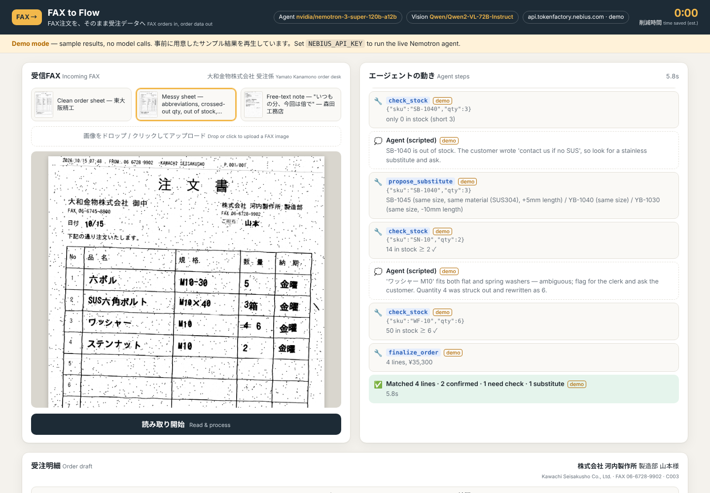
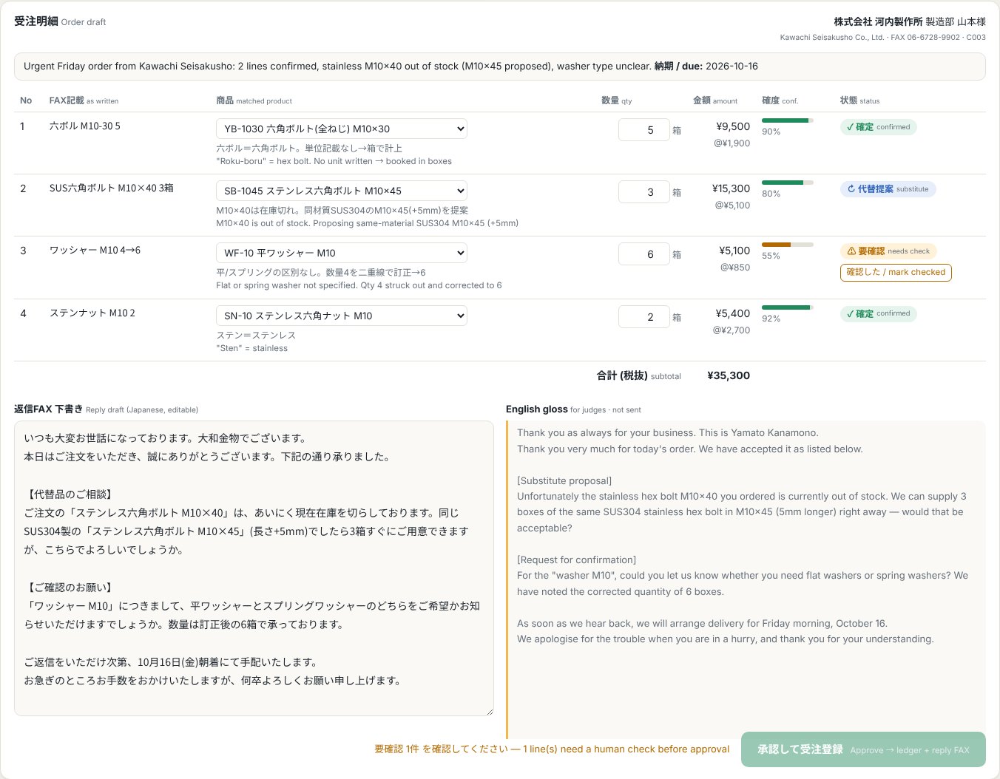
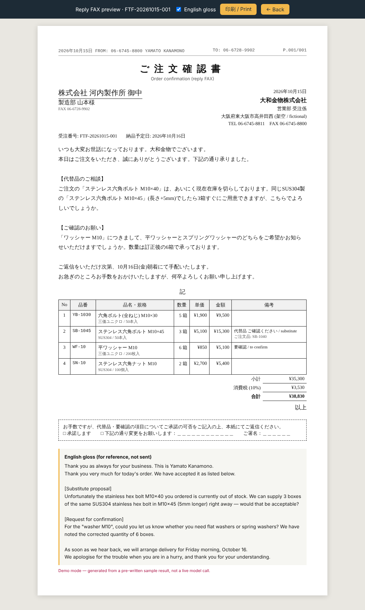

# FAX to Flow

**FAX orders in, approved order data out.** An agent built on NVIDIA Nemotron and Nebius Token Factory for Japanese SME wholesalers that still take orders by FAX.

> Nebius x NVIDIA Global AI Hackathon · Track: **Best Apps & Agents**



## The problem

In 2026, thousands of small wholesalers in Japan still receive most of their orders by FAX: hand-filled order sheets, shorthand like 「六ボル M10-30」, crossed-out quantities, and notes like 「いつもの分、今回は倍で」 ("the usual, doubled this time"). Every morning a clerk re-types each sheet into the order system, checks stock, phones about anything unclear, and writes a polite reply FAX. That takes about 5 minutes per sheet, and mistakes are common.

## What FAX to Flow does

Drop in a FAX image and the agent:

1. **Reads the FAX.** A vision model transcribes the sheet into raw JSON exactly as written, without corrections.
2. **Identifies the customer** from the fax-machine header stamp.
3. **Matches every line to the product master.** A fuzzy matcher handles trade shorthand, katakana/half-width variants and `M10-30` vs `M10×30`, and checks thread size, length and material.
4. **Checks stock** and **proposes substitutes** for out-of-stock or short items (same size and material, nearest length). It splits a line when only part is in stock.
5. **Expands "the usual"** from the customer's order history and applies multipliers like 倍 (×2).
6. **Flags uncertainty** honestly: ambiguous items and crossed-out quantities become **⚠ needs check** and are never guessed silently.
7. **Drafts the reply FAX** in polite business Japanese (keigo), with an English gloss for non-Japanese readers.

A human clerk reviews the draft, edits quantities or picks the right SKU, marks flagged lines as checked, and clicks **Approve**. The order is written to the ledger (downloadable CSV) and a printable reply FAX opens (`/reply/:id`). The header counter shows the estimated time saved compared with manual entry.

| | |
|---|---|
|  |  |

### Three demo samples (in `samples/`)

| Sample | Shows |
|---|---|
| `sample1_clean.png`: 東大阪精工 | Routine sheet with 4 lines, all matched and in stock |
| `sample2_messy.png`: 河内製作所 | Shorthand (六ボル, ステンナット), a 二重線 crossed-out quantity, an **out-of-stock** stainless bolt (substitute proposed), and an **ambiguous** 「ワッシャー M10」 (flat or spring?) |
| `sample3_usual.png`: 森田工務店 | Free text 「いつもの分、今回は倍で」: the agent pulls the customer's usual order, doubles it, finds one item short and proposes a substitute for the shortfall |

The fictional wholesaler is 大和金物株式会社 (Yamato Kanamono), a fastener and hardware wholesaler in Higashi-Osaka, with a 43-SKU master (`data/products.json`) and 8 customers (`data/customers.json`).

## How NVIDIA Nemotron and Nebius Token Factory are used

All model calls go to **Nebius Token Factory** through its OpenAI-compatible API (`POST https://api.tokenfactory.nebius.com/v1/chat/completions`, `Authorization: Bearer $NEBIUS_API_KEY`). There is no SDK, only `fetch` (see `lib/llm.mjs`).

| Step | Model (env var) | Role |
|---|---|---|
| 1. Transcription | `VISION_MODEL`; if empty, picked from the Token Factory catalogue on first use, preferring an NVIDIA VL model (e.g. Nemotron VL), else any VL model | Converts the FAX image (base64 data URL in an `image_url` content part) into raw JSON exactly as written. **It makes no decisions.** |
| 2+. **Agent brain** | `LLM_MODEL`, default **`nvidia/nemotron-3-super-120b-a12b`** | **Nemotron does all the reasoning.** It identifies the customer, decides which lines are ambiguous, chooses SKUs, interprets 「いつもの・倍」, decides on substitutes and line splits, infers the due date (金曜 → the coming Friday), and writes the keigo reply plus the English gloss. |

**Agent loop (`lib/agent.mjs`).** Nemotron runs a standard OpenAI tool-calling loop (`tools` + `tool_choice: "auto"`, up to 16 turns). The tools are defined as JSON schemas in `lib/tools.mjs`:

- `lookup_customer(fax_or_name)`
- `search_products(query)`: fuzzy scorer over names, aliases and specs (returns candidates, scores and an `ambiguous` flag)
- `check_stock(sku, qty)`
- `get_usual_order(customer_id)`
- `propose_substitute(sku, qty)`
- `finalize_order(...)`: submits the structured draft and reply

**Fallback.** If the endpoint rejects `tools` (HTTP 400/422 on the first call) or the model stops without finalizing, the server switches to a **JSON-plan protocol**: Nemotron returns `{"thought", "actions":[{tool, args}]}` (with `response_format: json_object` when supported), the server executes the actions and sends the results back, and the loop repeats. Nemotron stays the decision-maker in both modes.

**Guardrails.** Nemotron decides; the server verifies. `finalize_order` rejects unknown SKUs or customers (so the model can correct itself), takes **all prices from the master** and never from the model, and **downgrades any "confirmed" line that exceeds stock** to "needs check". Nothing reaches the ledger without human approval.

Swap models with environment variables, for example `LLM_MODEL=nvidia/Nemotron-3-Ultra-550b-a55b` for harder sheets or `nvidia/Nemotron-3_5-Lightning` for speed.

## Run it

Requirements: **Node 20+** only. There are no npm dependencies and nothing to install.

```bash
git clone <this repo> && cd fax-to-flow

# Demo mode (no key): replays pre-written results for the 3 samples
node server.mjs
# → http://localhost:3000

# Live mode: Nemotron on Nebius Token Factory
cp .env.example .env        # put your NEBIUS_API_KEY in .env
npm run dev                 # = node --env-file=.env server.mjs
# or: NEBIUS_API_KEY=... node server.mjs
```

**Demo mode.** Without `NEBIUS_API_KEY` the app still works end to end and shows the banner *"Demo mode — sample results, no model calls"*. It replays hand-written fixtures (`fixtures/*.json`) for the three bundled samples. The tool calls in each fixture really run against the product master, but the transcription, the agent's choices and the reply text are pre-written. Every demo step is tagged `demo`, and demo reply FAXes say so. Uploading your own image requires live mode.

Useful URLs: `/?sample=sample2_messy&autorun=1` (deep link), `/api/ledger.csv`, `/api/stats`, `/healthz`.

Checks: `npm test` (matcher and fixture validation, no key needed). `npm run smoke` checks the live Token Factory setup: it lists Nemotron and vision models, then runs the messy sample end to end. Regenerate sample FAX images with `npm run samples` (Python 3 + Pillow).

### Configuration

| Variable | Default | |
|---|---|---|
| `NEBIUS_API_KEY` | (none) | Enables live mode |
| `LLM_BASE_URL` | `https://api.tokenfactory.nebius.com/v1` | Any OpenAI-compatible endpoint |
| `LLM_MODEL` | `nvidia/nemotron-3-super-120b-a12b` | Agent brain |
| `VISION_MODEL` | empty = auto-pick (NVIDIA VL preferred) | Transcription only |
| `PORT` | `3000` | |
| `LLM_TIMEOUT_MS` / `LLM_MAX_TOKENS` | `120000` / `8192` | Per request |
| `MANUAL_SECONDS_PER_SHEET` | `300` | Baseline for the time-saved counter |
| `LEDGER_PATH` | `data/orders.csv` | Order ledger CSV |

### Deploy on Render

`render.yaml` defines a Node web service (`node server.mjs`, health check `/healthz`). Create a Blueprint from the repo and set `NEBIUS_API_KEY` in the dashboard (it is `sync: false`, so it is never committed). Note: Render's free-tier filesystem is ephemeral, so the ledger resets on redeploy. That is fine for a demo; a real deployment would write to a database or spreadsheet.

## Project layout

```
server.mjs            HTTP server, jobs, SSE step stream, approve → ledger
lib/llm.mjs           Token Factory chat-completions client (fetch), JSON helpers
lib/agent.mjs         Vision transcription + Nemotron tool-calling loop + JSON-plan fallback
lib/tools.mjs         Tool schemas + executors + server-side validation
lib/match.mjs         Fuzzy matcher for hand-written Japanese order lines
lib/demo.mjs          Demo-mode fixture playback
lib/store.mjs         Product/customer master, CSV ledger
lib/reply-page.mjs    Printable reply FAX (ご注文確認書)
public/               Single-page UI (vanilla JS, no framework)
data/                 products.json, customers.json, orders.csv (ledger)
samples/              3 generated FAX images · scripts/make_samples.py
fixtures/             Demo-mode results for the samples
docs/                 Screenshots, demo video script
```

## Limitations and next steps

- The live path has been tested against a local mock of the chat-completions + tools protocol, not yet against Token Factory itself. Model IDs are configurable in case the catalogue changes.
- Approving an order does not reduce stock (so the demo can be repeated).
- Next: incoming-FAX inbox (e-fax / multifunction-printer email), sending the reply FAX automatically, learning new aliases from clerk corrections, and connectors for common Japanese order and accounting systems.

## License

MIT. See [LICENSE](LICENSE). All companies, people and phone numbers in the data are fictional.
